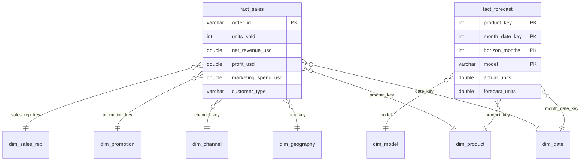
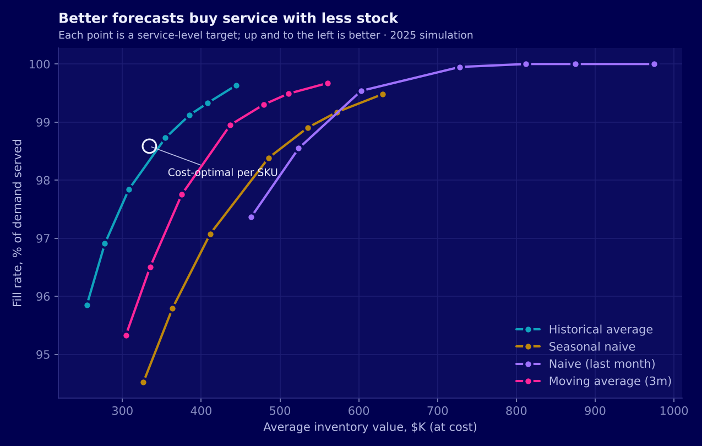

# FMCG Sales Analytics & Demand Forecasting

**Case study:** [daxtonhuynh.github.io/fmcg-demand-forecasting](https://daxtonhuynh.github.io/fmcg-demand-forecasting/) ·
**Dashboards:** [sales & forecast accuracy](https://daxtonhuynh.github.io/fmcg-demand-forecasting/dashboard/) ·
[inventory planning](https://daxtonhuynh.github.io/fmcg-demand-forecasting/uncertainty_planning/dashboard/)

An end-to-end analytics project on three years of FMCG transactions (18,240 orders,
30 SKUs, 17 countries, 2023 to 2025): data audit, cleaning, exploratory analysis of
sales and profitability, a SQL star-schema warehouse, an interactive two-page
dashboard, and a demand forecast that tests one planning question:

> **Do commercial drivers (marketing, discount, price) make the forecast more
> accurate than sales history alone?**

The EDA suggested marketing was by far the strongest driver of revenue. A first
forecast built on that idea scored an impressive 14% error. Auditing every input
showed why: marketing spend is booked *after* the sale, so the model was reading the
answer. With leakage removed, the best forecast is also the simplest one.

A second pipeline, [`uncertainty_planning/`](uncertainty_planning/README.md), then
builds the planning layer around that error: forecast ranges checked for honesty,
one set of numbers from SKU to company, 552 replenishment policies simulated month by
month and priced, and an estimate of what better information is worth.

**Tech:** Python (pandas, scikit-learn, SciPy, matplotlib) · SQL (DuckDB: star schema,
CTEs, window functions) · Power BI (DAX, Power Query) · JavaScript dashboards (ECharts) ·
Parquet · rolling-origin time-series validation · gradient boosting and Ridge
regression · bootstrap confidence intervals · split-conformal intervals · hierarchical
reconciliation (MinT) · inventory simulation · pytest · GitHub Pages

---

## Results at a glance

| | |
|---|---|
| **Data quality** | 0 missing values, 0 duplicates, 0 impossible values; every financial formula reconciles to the cent |
| **Business performance** | $14.45M net revenue, 22.9% profit margin; B2B is 75.5% of revenue; Beverages is the largest category but has the lowest margin (14.0%) |
| **SQL warehouse** | DuckDB star schema (2 facts, 7 dimensions); 15/15 data-quality checks pass; all 102 SQL figures reconcile with the Python results |
| **Dashboard** | Two pages (sales & profitability, forecast accuracy & planning) with region, country, category, channel, customer and time filters; HTML version runs in any browser, plus a Power BI kit |
| **Apparent forecast accuracy** | 13.5% WAPE, but only by using same-month marketing spend, which is only known after the sale |
| **Honest forecast accuracy** | **28.2% WAPE** per SKU-month · **7.1%** on the company total (1 month ahead) |
| **Best model** | Each SKU's historical average. No regression or gradient-boosting model beats it. |
| **Value of commercial drivers** | Lagged marketing, discount and price change WAPE by 0.5 points or less |
| **Planning: forecast ranges** | Normal-theory ranges promise 95% but cover 92.8% of 2025 SKU-months; conformal ranges cover 96.1%; a monthly monitor flags the gap in May 2025 |
| **Planning: stock policy** | Per-SKU cost-optimal service targets: $334K of stock, 98.6% fill rate, 4.7% cheaper than one 95% target for every SKU in the base case, and cheaper in all 18 assumption sets tested |
| **Planning: value of information** | Seeing large B2B orders early takes SKU error from 28.2% to 18.9% and stock down 20% (upper bound) |


## Pipelines

```
data/raw/*.csv
   │  1. Data audit ............ dictionary, quality checks, formula reconciliation, outlier scan
   │  2. Data cleaning ......... types, labels, outlier tiers (no rows dropped) ──> data/processed/
   │  3. Feature engineering ... time features, ratios, monthly tables ──────────> data/modelling/
   │  4. EDA ................... performance, products, customers, geography, drivers
   │  5. Forecast validation ... leakage audit, rolling-origin model comparison, ablation
   │  6. SQL warehouse ......... star schema, quality checks, business queries ──> data/warehouse/
   │  7. Dashboard data ........ aggregated data for the HTML dashboard, CSVs for Power BI ──> dashboard/
   │
   │  uncertainty_planning/ (reads data/raw only)
   │  P1 Demand panel .......... SKU x month, unit economics, large-order split
   │  P2 Probabilistic forecast  quantiles from past errors, calibration, monitor
   │  P3 Hierarchy ............. Total > Category > Brand > SKU, reconciled
   │  P4 Inventory policy ...... 552 policies simulated month by month, priced
   │  P5 Information ........... value of pipeline visibility, planner overrides (FVA)
   │  P6 Warehouse ............. planning.duckdb: 17 checks, 9 queries, SQL = Python
   ▼  P7 Dashboard data ........ uncertainty_planning/dashboard/data.js
outputs/<stage>/  ·  uncertainty_planning/outputs/<stage>/  ·  index.html (case study)
```

One command per pipeline: `python run_pipeline.py` and `python uncertainty_planning/run_planning.py`.

## 1. Business problem

Demand planners need a monthly unit forecast per SKU to set production,
replenishment and safety stock. Commercial teams believe marketing, discounts and
pricing drive demand, so a forecast that includes them should beat history alone.
The business also wants to know where revenue and margin come from: which
categories, customers, channels and markets.

## 2. Data audit and cleaning (stages 1–2)

- 18,240 orders, 27 columns, no missing values, no duplicate orders, no impossible
  values (negative units, discounts above 100%, and so on).
- Gross sales, net revenue, profit and margin are exact formulas of units, price,
  discount and costs. Profit is net revenue minus COGS, logistics **and marketing**.
- 3,150 orders (17%) are statistical outliers on at least one measure. They were
  **classified, not removed**: 2,563 are bulk B2B or wholesale orders, 238 are
  seasonal peaks and 349 are other valid extremes. Dropping them would erase real
  demand.
- 784 orders (4.3%) are loss-making: 74% are online orders, at about half the
  typical order size. They are flagged as a business signal, not an error.
- Raw and cleaned totals reconcile exactly; the cleaned table is saved as Parquet so
  dates, categories and flags keep their types.

## 3. Exploratory analysis (stages 3–4)

| Finding | Evidence |
|---|---|
| Steady growth with a December peak | Revenue +5.4% in 2024 and +3.6% in 2025; December is the strongest month |
| Biggest category ≠ most profitable | Beverages: $3.74M revenue at 14.0% margin; Personal Care: 28.1% margin |
| B2B carries the business | 75.5% of revenue at 24.5% margin vs 18.0% for B2C |
| Online is the weakest channel | 12.4% margin vs 25.9% for Wholesale |
| Marketing looks like the dominant driver | r = 0.96 between marketing spend and revenue (Month x Country) |
| Bigger discounts, bigger orders | Average order rises from 76 units (0–5% discount) to 377 units (20%+); B2B averages a 16.1% discount vs 9.7% for B2C |


The last two rows became hypotheses for the forecast: if marketing and discount
drive sales, they should improve a forecast.

## 4. The challenge: a forecast that was too good

A first version of the forecast (revenue by Month x Country x Category, gradient
boosting) reported **14.1% WAPE**, against about 47% for history alone. Same-month
marketing spend carried **89%** of the model's feature importance.

Before trusting it, every input was checked against one rule: **a feature is allowed
only if its value is known when the forecast is made.** The leakage audit found:

- Marketing is booked on each order as a share of that order's value (median 11% of
  gross sales). At company level it tracks the **same** month's units (r = 0.81) but
  not the **next** month's (r = −0.01). It follows the sale; it does not drive it.
- The discount-volume link is volume-tier pricing, not promotional lift: promoted and
  non-promoted orders have the same average size (about 213 units).


## 5. Forecast validation (stage 5)

The forecast was rebuilt as units per SKU per month, tested on every month of 2025
with a rolling origin (refit each month on data known at that point), 1 and 3 months
ahead. Full design rationale: [`docs/methodology.md`](docs/methodology.md).

| Model | WAPE 1m | WAPE 3m | Total WAPE 1m | Usable in planning |
|---|---:|---:|---:|:---:|
| Historical average (all known months) | **28.2%** | **28.1%** | 7.1% | ✓ |
| GBM: history + planned discount & price | 28.8% | 28.5% | 9.2% | scenario |
| Ridge: history only | 29.2% | 29.2% | 8.6% | ✓ |
| Ridge: history + lagged drivers | 29.5% | 29.3% | 8.5% | ✓ |
| Moving average (3 months) | 31.2% | 31.3% | 8.6% | ✓ |
| GBM: history only | 31.3% | 30.2% | 10.0% | ✓ |
| GBM: history + lagged drivers | 31.6% | 29.7% | 9.2% | ✓ |
| Naive (last known month) | 39.6% | 36.3% | 9.2% | ✓ |
| Seasonal naive (same month last year) | 40.7% | 40.7% | **6.6%** | ✓ |
| GBM: + same-month marketing (leaky) | 13.5% | 14.2% | 3.1% | ✗ |

- Removing same-month marketing alone raises WAPE from 13.5% to 28.8%.
- One month ahead, Ridge, gradient boosting and every lagged-driver model are
  **significantly worse** than the historical average (bootstrap 95% CI above zero).
  The planned discount-and-price scenario is not significantly different from it.
- **Why so little gain?** Within each SKU, month-to-month autocorrelation is about 0
  and calendar month explains about 2% of the variation. Even perfect knowledge of
  each SKU's 2025 average would leave **26.2%** WAPE. That is the noise floor.
- For the company total, last year's same month is the best simple benchmark (6.6%),
  because summing 30 SKUs cancels most noise and December peaks every year.


## 6. SQL warehouse (stage 6)

The cleaned orders and the 2025 forecasts are loaded into a DuckDB star schema with
primary and foreign keys ([`sql/schema.sql`](sql/schema.sql)). The same model feeds
both dashboards.



**Data quality** ([`sql/data_quality.sql`](sql/data_quality.sql)): 15 checks on
completeness, key integrity, business rules and reconciliation with the raw file.
All pass, and the pipeline stops if any fails.

**Business queries** ([`sql/business_analysis.sql`](sql/business_analysis.sql)), one
CSV each in `outputs/06_sql/`:

| Query | Business question | SQL techniques |
|---|---|---|
| `q1_monthly_kpi_trend` | Month-on-month and year-on-year growth, rolling 3-month revenue | CTE, `LAG`, window frame |
| `q2_brand_performance` | Brand rank within category, share of category, margin rank | `RANK`, `SUM OVER (PARTITION BY)` |
| `q3_channel_customer_matrix` | B2B vs B2C by channel, loss-making order share | Conditional aggregation |
| `q4_country_growth` | Revenue by year and growth 2023–2025 per market | Pivot with `CASE`, `RANK` |
| `q5_discount_bands` | Order size, margin and B2B share by discount band | `CASE` banding, `MEDIAN` |
| `q6_sku_pareto_abc` | Revenue concentration and ABC class per SKU | Cumulative window `SUM` |
| `q7_marketing_timing` | Does marketing lead or follow sales? | `LAG`, `CORR` |
| `q8_forecast_accuracy` | WAPE, bias and rank per forecast model | Multi-level CTE, `RANK` |

```sql
-- q6: ABC classification of SKUs by cumulative revenue share
WITH sku AS (
    SELECT p.sku, p.product_name, sum(f.net_revenue_usd) AS revenue
    FROM fact_sales f
    JOIN dim_product p USING (product_key)
    GROUP BY p.sku, p.product_name
),
ranked AS (
    SELECT *,
           100 * sum(revenue) OVER (ORDER BY revenue DESC
                                    ROWS BETWEEN UNBOUNDED PRECEDING AND CURRENT ROW)
               / sum(revenue) OVER () AS cumulative_share
    FROM sku
)
SELECT sku, product_name, revenue, cumulative_share,
       CASE WHEN cumulative_share <= 80 THEN 'A'
            WHEN cumulative_share <= 95 THEN 'B'
            ELSE 'C' END AS abc_class
FROM ranked
ORDER BY revenue DESC;
```

What the queries added:

- **The top SKU is one of the least profitable.** Instant Coffee Gold is the #1 SKU
  ($1.17M, 8.1% of revenue) at a 9.8% margin. The four lowest-margin SKUs are all
  Beverages.
- **Revenue is spread, not concentrated:** the top 20 of 30 SKUs make up just under
  80% of revenue, so there is no small "A" group to focus on.
- **Online loses money on 1 in 10 orders** (10.4%, average order $256), against
  under 1% in Wholesale and Distributor (average orders $1,829 and $1,227).

**Reconciliation:** the pipeline recomputes 102 figures in SQL (totals, yearly
revenue, category, channel, customer type, country growth, discount bands, marketing
timing, forecast WAPE) and checks them against the Python results. All 102 match
exactly ([`reconciliation_sql_vs_python.csv`](outputs/06_sql/reconciliation_sql_vs_python.csv)).

## 7. Dashboard (stage 7)

Two pages built on the warehouse, in the project's navy-and-neon theme (`#000050`
base, validated for colour-blind separation). One filter row scopes every chart on the
page, and every chart has a table view.

- **Sales & Profitability:** KPI cards with year-on-year change, monthly revenue and
  margin, category, channel (B2B vs B2C), loss-making orders, markets and an SKU table
  with ABC classes.
- **Forecast Accuracy & Planning:** model comparison against the noise floor, WAPE by
  category or SKU, actual vs forecast with a planning band, and SKU-level accuracy.

[`dashboard/index.html`](dashboard/index.html) runs in any browser and is published
with GitHub Pages. Its figures were checked against SQL under 15 filter combinations.
The [Power BI kit](dashboard/powerbi/README.md) (theme, Power Query, DAX measures,
layout and expected values) rebuilds the same two pages in Power BI Desktop.


## 8. Recommendations

Full evidence, illustrative upside and KPIs to track:
[`docs/business_recommendations.md`](docs/business_recommendations.md).

1. **Fix Beverages margins at the cost line.** The four lowest-margin SKUs, including
   the #1 seller Instant Coffee Gold (9.8% margin), are all Beverages, with COGS at
   67–73% of revenue against 59.5% overall. Discounts are not the cause.
2. **Bring down Online cost-to-serve.** Online earns 12.4% (Wholesale 25.9%), with a
   $217 median order and logistics at 10.8% of revenue; one order in ten loses money.
   Test a minimum basket or delivery fee.
3. **Protect B2B and read discounts as volume pricing.** B2B is 75.5% of revenue at
   24.5% margin; bigger discounts follow bigger B2B orders, not promotions. Test lift
   before adding promotional spend.
4. **Plan with simple baselines and size safety stock from the error.** SKU historical
   average for replenishment, last year's same month for totals, buffers sized from the
   ~28% SKU-month error. The planning extension (section 9) does exactly this.
5. **Record marketing as a plan and audit inputs for leakage.** Budgets set before the
   month are needed to measure marketing's effect; the 14% result could never be
   reproduced in planning.

## 9. Extension: uncertainty-aware demand planning

If SKU demand cannot be forecast better from history, how much stock should be held,
what does each level of service cost, and which information would reduce the error?
[`uncertainty_planning/`](uncertainty_planning/README.md) answers with a second,
self-contained pipeline (P1–P7) that reads the same raw file and writes only inside
its own folder.

| | |
|---|---|
| **Forecast ranges** | Quantiles from past errors (Normal, split-conformal, volatility-scaled). Normal ranges cover 92.8% against a 95% promise in 2025; conformal ranges 96.1%. A monthly calibration monitor flags the gap in May 2025 |
| **One set of numbers** | Total, category, brand and SKU forecasts reconciled to add up (bottom-up, top-down, OLS, WLS, MinT). Top-down: 6.6% WAPE at the total, 28.3% at SKU level |
| **Inventory policy** | 552 order-up-to policies replayed month by month with lead time, carry-over and lost sales, priced under 6 cost assumptions. Per-SKU cost-optimal targets: $334K stock, 98.6% fill, $100.0K a year, 4.7% cheaper than a uniform 95% target |
| **Value of information** | Orders of 515+ units are 10% of orders, 33% of units and 97% B2B. Seeing half of them early: 23.9% WAPE, $28K less stock; all of them: 18.9% WAPE, 20% less stock (upper bound) |
| **Planner overrides** | Simulated Forecast Value Added: informed +4.1 points; optimistic −1.5; trend-chasing −3.5 |
| **Planning warehouse** | `planning.duckdb`: 3 dimensions, 7 facts; 17/17 checks pass; 320/320 SQL figures match Python |
| **Next action** | January 2026 replenishment plan: 125K units, $291K at cost |

Details, figures and limitations: [`uncertainty_planning/README.md`](uncertainty_planning/README.md),
[`methodology`](uncertainty_planning/docs/methodology.md),
[`assumptions`](uncertainty_planning/docs/assumptions.md) and the
[`decision memo`](uncertainty_planning/docs/decision_memo.md).



## 10. Case study page

[`index.html`](index.html) at the repository root is the portfolio case study published
with GitHub Pages: the question, the data (what each order holds, how revenue becomes
profit, both warehouses), the forecast, the planning system, the value of information,
method, actions and limits. Every chart is plain HTML with a CSV download in
[`assets/data/`](assets/data/).

The page is generated from the pipeline outputs by
[`tools/case_study/build_case_study.py`](tools/case_study/README.md), so its numbers
never drift from the results. Publishing steps are in the same README.

## Limitations

- 36 months of history: two observations per calendar month before the test year.
- The dataset shows signs of being synthetic (very even order counts, 100+ prices per
  SKU, no autocorrelation), so results describe this data, not FMCG in general.
- EDA correlations are descriptive, not causal.
- The planned-driver scenario assumes discounts and prices are known in advance; since
  the realised discount follows order mix, its result is an upper bound.
- The planning results are a simulation: stock, lead times and costs are assumptions,
  tested across 18 combinations ([`assumptions.md`](uncertainty_planning/docs/assumptions.md)).

## Repository structure

```
├── index.html                     # case study page (GitHub Pages)
├── .nojekyll                      # serve the site as plain files
├── assets/                        # favicon, share image, screenshot, one CSV per chart
├── run_pipeline.py                # runs stages 1-7 in order
├── requirements.txt
├── pipeline/
│   ├── 01_data_audit.py
│   ├── 02_data_cleaning.py
│   ├── 03_feature_engineering.py
│   ├── 04_eda.py
│   ├── 05_forecast_validation.py
│   ├── 06_sql_warehouse.py
│   └── 07_dashboard_data.py
├── sql/
│   ├── schema.sql                 # star schema with primary and foreign keys
│   ├── data_quality.sql           # 15 checks
│   └── business_analysis.sql      # 8 named business queries
├── src/forecasting/               # stage 5 logic
│   ├── config.py                  # every locked design choice
│   ├── leakage_audit.py           # formula checks, driver signals, feature availability
│   ├── features.py                # SKU-month panel and leakage-safe features
│   ├── models.py                  # baselines, Ridge, gradient boosting, ablation sets
│   ├── evaluation.py              # rolling origin, metrics, bootstrap intervals
│   └── plots.py
├── dashboard/
│   ├── index.html                 # interactive two-page dashboard (open in a browser)
│   ├── data.js                    # aggregated data, written by stage 7
│   ├── screenshots/
│   └── powerbi/                   # theme, Power Query, DAX measures, build guide
├── uncertainty_planning/          # planning extension (P1-P7), see its README
│   ├── run_planning.py
│   ├── pipeline/  src/planning/  sql/  tests/
│   ├── dashboard/                 # inventory-planning dashboard
│   ├── docs/                      # methodology, assumptions, decision memo
│   └── outputs/
├── tools/case_study/              # rebuilds index.html and assets/data from the outputs
├── .github/workflows/tests.yml    # runs the planning unit tests on every push
├── data/                          # raw/ (you add); processed/, modelling/, warehouse/ (generated)
├── docs/
│   ├── methodology.md
│   └── business_recommendations.md
└── outputs/
    ├── 01_data_audit/             # data dictionary, audit summary, diagnostic plots
    ├── 02_data_cleaning/          # cleaning summary, outlier tiers, reconciliation
    ├── 03_feature_engineering/    # data dictionary v3, reconciliation
    ├── 04_eda/                    # eda_summary.json + 21 charts
    ├── 05_forecasting/            # tables/ (model comparison, ablation, predictions) + figures/
    └── 06_sql/                    # quality checks, 8 query results, SQL-vs-Python reconciliation
```

## How to run

```bash
git clone https://github.com/daxtonhuynh/fmcg-demand-forecasting.git && cd fmcg-demand-forecasting
python -m venv .venv && source .venv/bin/activate
pip install -r requirements.txt -r uncertainty_planning/requirements.txt
# put the dataset at data/raw/fmcg_sales_marketing_profitability_2023_2025.csv
python run_pipeline.py                          # stages 1-7, about 2 minutes
python uncertainty_planning/run_planning.py     # planning P1-P7, about 1 minute
python tools/case_study/build_case_study.py     # rebuild the case study page from the outputs
python -m pytest uncertainty_planning/tests -q  # planning unit tests (no dataset needed)
open index.html                                 # the case study; dashboards link from it

# explore the warehouses yourself
python -c "import duckdb; print(duckdb.connect('data/warehouse/fmcg.duckdb').sql('SELECT * FROM fact_sales LIMIT 5'))"
python -c "import duckdb; print(duckdb.connect('uncertainty_planning/data/warehouse/planning.duckdb').sql('SHOW TABLES'))"
```

Results are deterministic: with the pinned scikit-learn version, re-running
reproduces every table exactly; the planning pipeline uses fixed random seeds.

## Author

**Pham Quoc Dat Huynh (Daxton Huynh)** · Master of Big Data Analytics, Trent University ·
[Portfolio](https://daxtonhuynh.github.io/portfolio/)
