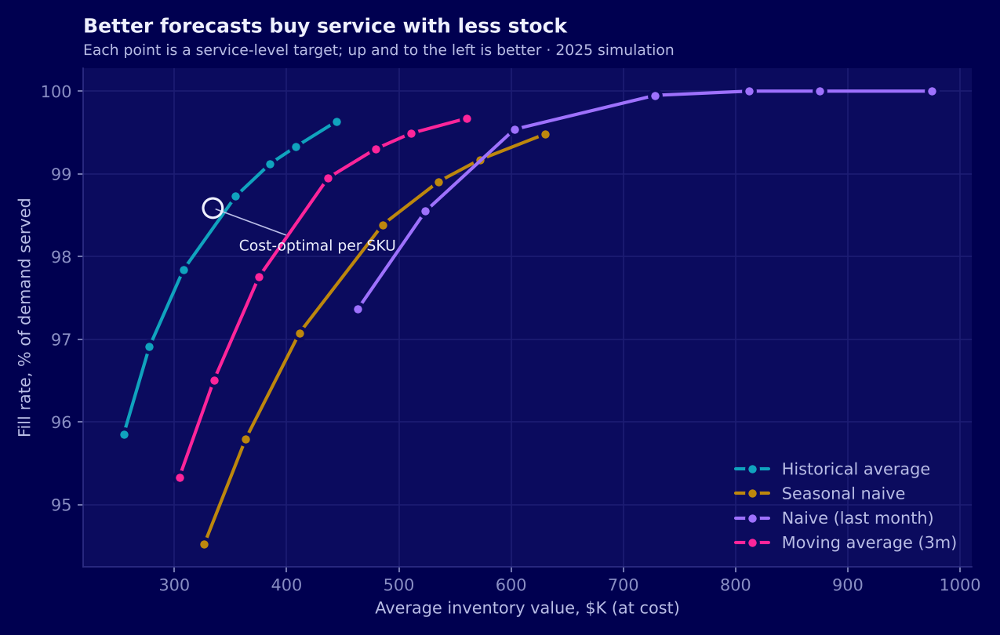
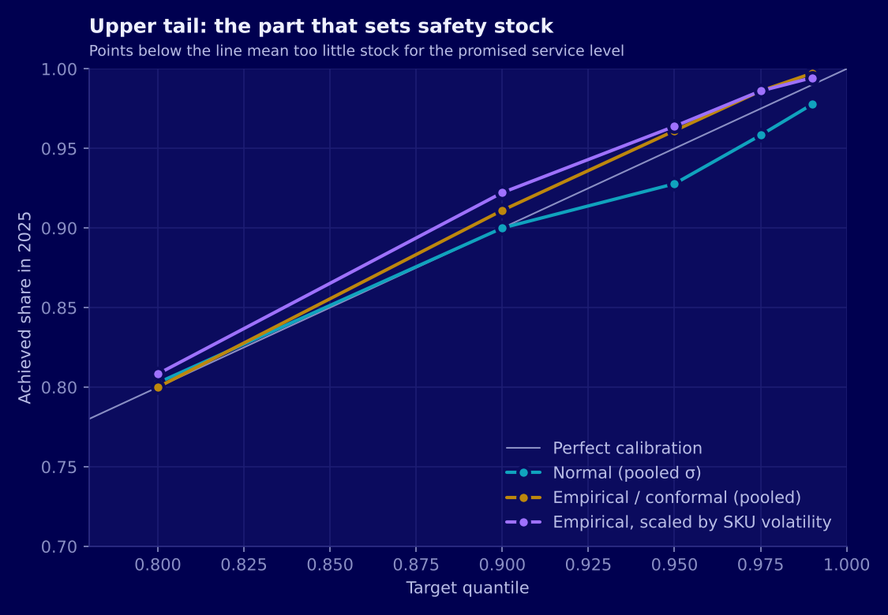
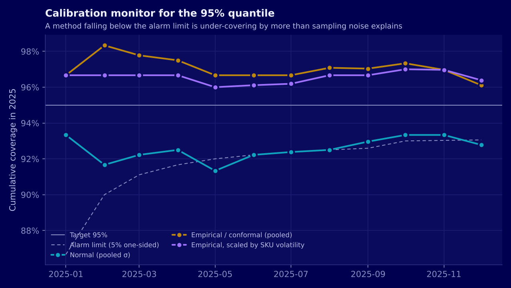
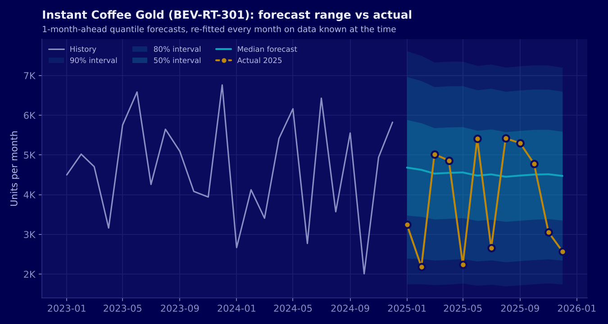
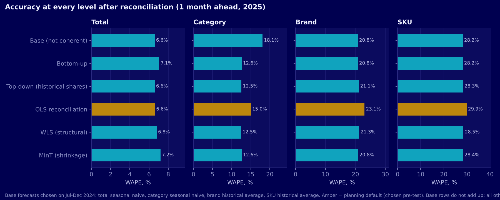
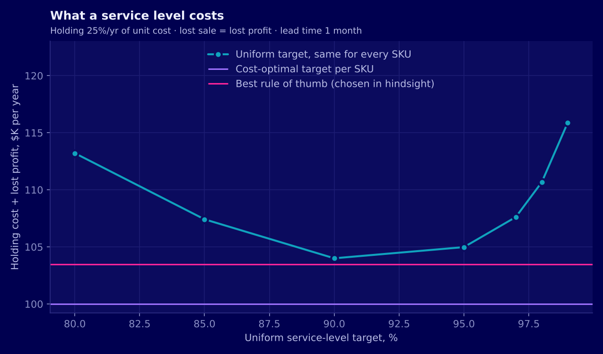
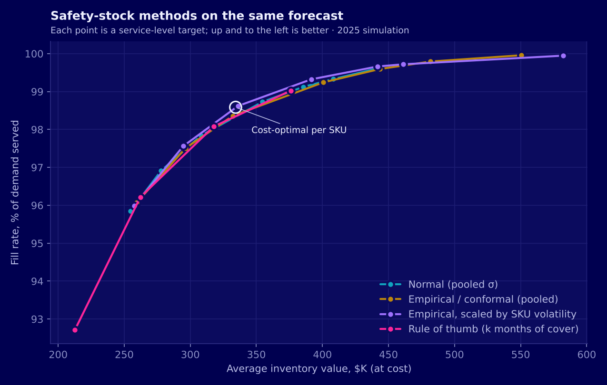
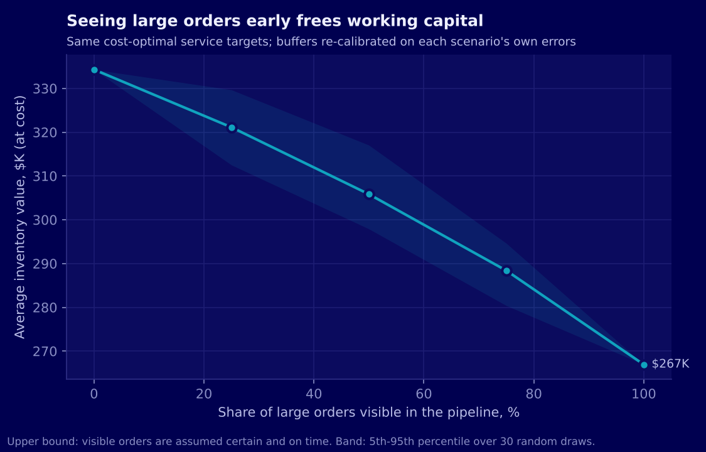
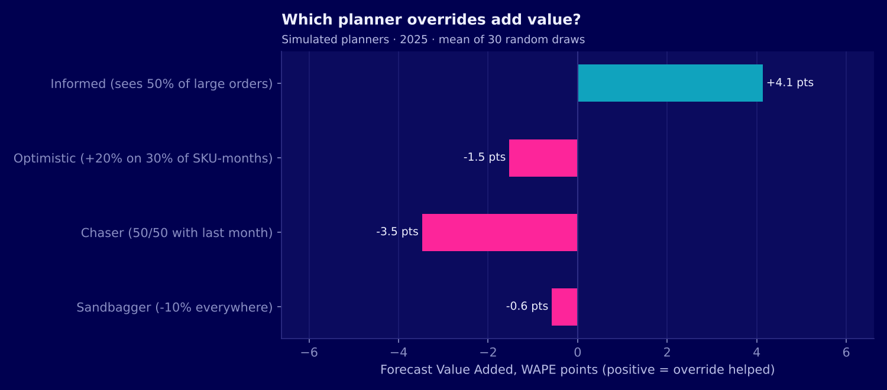
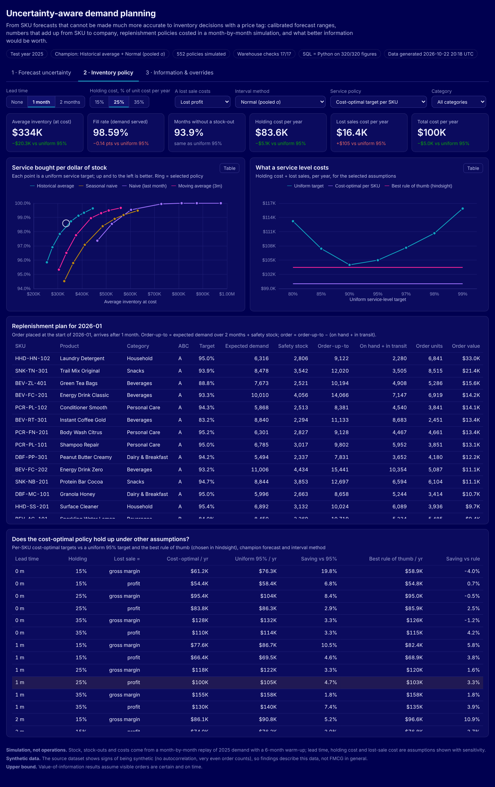

# Uncertainty-Aware Demand Planning

*An extension of the [FMCG Sales Analytics & Demand Forecasting](../README.md) project.* Case study page:
[daxtonhuynh.github.io/fmcg-demand-forecasting](https://daxtonhuynh.github.io/fmcg-demand-forecasting/).
This folder is self-contained: it reads the same raw dataset and writes only inside
`uncertainty_planning/`. Nothing in the main project is changed.

The main project ended with an honest result: once leakage is removed, no model beats
each SKU's historical average (28.2% WAPE one month ahead, against a noise floor of
about 26%), and commercial drivers add nothing. That raises the question a planner
actually faces:

> **If SKU demand cannot be forecast better from history, how much stock should we
> hold, what does each level of service cost, and which information would reduce the
> uncertainty?**

This extension builds the planning layer that answers it: forecast *ranges* that are
checked for honesty, one set of numbers from SKU to company, a month-by-month
inventory simulation that prices every policy, and an estimate of what better
information and planner overrides are worth.

**Tech:** Python (pandas, NumPy, SciPy, matplotlib) · split-conformal prediction
intervals · hierarchical forecast reconciliation (OLS, WLS, MinT with shrinkage) ·
periodic-review inventory simulation · DuckDB (star schema, window functions, ROLLUP) ·
interactive dashboard (ECharts) · pytest

---

## Results at a glance

| | |
|---|---|
| **Forecast ranges** | Normal-theory ranges promise 95% but cover **92.8%** of 2025 SKU-months; conformal ranges cover **96.1%**. A monthly calibration monitor flags the Normal ranges by **May 2025** |
| **One set of numbers** | The historical average adds up from SKU to total by construction. Seasonal naive at the top, split down by historical shares: **6.6%** WAPE at the total, **28.3%** at SKU level |
| **Recommended policy** | Cost-optimal service target per SKU: **$334K** of stock at cost (1.3 months of demand), **98.6%** fill rate, **$100K** a year of holding + lost-sale cost |
| **vs a uniform 95% target** | **−$5.0K a year (−4.7%)** and **−$20K of stock**; better in **18 of 18** lead-time and cost assumption sets |
| **Forecasts ranked by cost** | Historical average is cheapest in **54 of 54** configurations. Two methods with similar WAPE (naive 39.6%, seasonal naive 40.7%) differ by **28%** in cost |
| **Value of information** | Seeing large B2B orders early: half of them → WAPE **23.9%**, **−$28K** stock, **−$9.9K** a year; all of them → **18.9%**, **−20%** stock, **−$22K** a year (upper bound) |
| **Planner overrides (FVA)** | Informed **+4.1** WAPE points; optimistic **−1.5**; trend-chasing **−3.5**; sandbagging **−0.6** (yet slightly cheaper: accuracy alone misjudges it) |
| **Next action** | January 2026 replenishment plan: **125K units, $291K** at cost |
| **Warehouse** | 17 / 17 data-quality checks pass; **320 / 320** SQL figures match Python |



## Pipeline

```
../data/raw/*.csv  (read only)
   │  P1 Demand panel ........... SKU x month, unit economics, large-order split
   │  P2 Probabilistic forecast . quantiles from past errors, calibration, monitor
   │  P3 Hierarchy .............. Total > Category > Brand > SKU, reconciled
   │  P4 Inventory policy ....... 552 policies simulated month by month, priced
   │  P5 Information ............ value of pipeline visibility, planner FVA
   │  P6 Warehouse .............. DuckDB: 17 checks, 9 queries, SQL = Python
   ▼  P7 Dashboard data ......... dashboard/data.js
outputs/<stage>/   data/processed/   data/warehouse/planning.duckdb
```

One command: `python run_planning.py` (about one minute).

## 1. Forecast ranges that mean what they say (P2)

A safety stock is a forecast quantile: holding enough to cover demand in 95% of months
means ordering up to the 95% quantile of demand over the lead time plus the review
period. So the first question is whether the quantiles are honest.

Each month, quantiles are built from the errors of earlier forecasts only, three ways:
the textbook Normal formula, split-conformal (the empirical quantile of past errors,
distribution-free), and conformal scaled by each SKU's volatility. Method choice uses
Jul–Dec 2024 only; 2025 is the test.

| Interval method | ≤ 90% quantile | ≤ 95% quantile | ≤ 99% quantile | 90% range width |
|---|---:|---:|---:|---:|
| Normal (pooled σ), selected on 2024 | 90.0% | **92.8%** | 97.8% | 122% of mean demand |
| Empirical / conformal | 91.1% | 96.1% | 99.7% | 124% |
| Empirical, scaled by SKU volatility | 92.2% | 96.4% | 99.4% | 130% |

- The three methods were almost tied on the 2024 selection period (pinball loss within
  3%). The Normal method won, then **under-covered the upper tail in 2025**, the part
  that sets safety stock.
- A **calibration monitor** (cumulative hits vs a binomial alarm limit) flags it in
  **May 2025**. In a planning process this is the trigger to switch method, without
  waiting for an annual review.
- Scaling by SKU volatility does not help here: per-SKU coverage spreads about as
  much as 12 months of sampling noise alone would predict (sd 0.084 vs 0.087).





## 2. One set of numbers from SKU to company (P3)

Finance plans on the total, commercial teams on categories, supply chain on SKUs. The
53 series (1 total, 5 categories, 17 brands, 30 SKUs) were forecast and reconciled so
every level adds up.

- **The historical average is already coherent:** it is linear, so SKU averages sum
  exactly to category and total averages. Every reconciliation method returns the same
  numbers.
- Mixing methods (seasonal naive for total and category, where December repeats) needs
  reconciliation. **Top-down with historical shares** gives the best of both: **6.6%**
  at the total, **12.5%** at category, **28.3%** at SKU.
- The planning default picked on 2024 (OLS) did slightly worse in 2025 (29.9% at SKU):
  differences between approaches are smaller than what six months of selection data
  can resolve. The gap between levels (7% vs 28%) is noise cancelling, not a weak SKU
  model.



## 3. From forecast to stock: inventory policy simulation (P4)

Each policy is replayed month by month from July 2024 (warm-up) to December 2025:
review once a month, order up to a level, receive after the lead time, lose unmet
demand, carry stock over. Only 2025 is scored. Policies: a uniform service target for
every SKU (80–99%), a **cost-optimal target per SKU** (critical ratio of lost profit to
one month of holding cost, set from unit economics, not tuned on 2025), and rules of
thumb (expected demand + *k* months of cover). 4 forecasts × 3 interval methods ×
targets × 3 lead times = **552 policies**, each priced under 6 cost assumptions.

| Policy (base case) | Avg stock | Fill rate | Months w/o stock-out | Cost / yr |
|---|---:|---:|---:|---:|
| **Cost-optimal target per SKU** | **$334K** | 98.6% | 93.9% | **$100.0K** |
| Uniform 95% target | $355K | 98.7% | 93.9% | $105.0K |
| Best rule of thumb (chosen in hindsight) | — | — | — | $103.5K |

- **Rank forecasts by what they cost.** The historical average is cheapest in all 54
  configurations. Naive and seasonal naive have similar WAPE (39.6% vs 40.7%) but the
  naive forecast's month-to-month swings cost **28% more**.
- **No single service level is right.** The best uniform target, chosen in hindsight,
  moves from 85% to 99% across lead times and cost assumptions. Per-SKU targets adapt
  on their own: 79% for Sparkling Water Berry (thin profit) up to 97% for Toothpaste Mint.
- **Buffer methods trace the same frontier here; calibration decides where a target
  lands on it.** The cheapest interval method is the best-calibrated one over the
  protection period: Normal with a 1–2 month lead time, conformal with no lead time.




The stage ends with an operational output: a **replenishment plan for January 2026**
(order-up-to level, safety stock, inventory position and recommended order per SKU),
**125K units, $291K at cost**.

## 4. What better information is worth (P5)

**Value of information.** Orders of 515+ units are 10% of orders but **33% of units**,
and **97% are B2B**: exactly the orders a CRM or distributor pipeline would show in
advance. A forecaster that sees a share *p* of them (randomly, 30 draws) was
re-calibrated and run through the same policy.

| Large orders visible | SKU WAPE | Avg stock | Stock reduction | Cost saving / yr |
|---|---:|---:|---:|---:|
| 0% (history only) | 28.2% | $334K | — | — |
| 25% | 26.3% | $321K | 3.9% | $4.8K |
| 50% | 23.9% | $306K | 8.5% | $9.9K |
| 75% | 21.7% | $288K | 13.7% | $14.4K |
| 100% | **18.9%** | **$267K** | **20.1%** | **$22.2K** |

Information is the only lever in this project that goes below the history-only error
floor. These figures assume visible orders are certain and on time, so they are an
upper bound.



**Forecast Value Added.** Four simulated planners override the statistical forecast;
each override is logged with a reason code and run through the inventory policy.

| Planner | FVA (WAPE pts) | Bias | Cost change / yr |
|---|---:|---:|---:|
| Informed (sees 50% of large orders) | **+4.1** | 0.0% | −$7.2K |
| Optimistic (+20% on 30% of SKU-months) | −1.5 | +5.1% | +$3.4K |
| Chaser (50/50 with last month) | −3.5 | −0.5% | +$7.0K |
| Sandbagger (−10% everywhere) | −0.6 | −10.8% | −$0.5K |

Two lessons for running an override process: the informed planner captures less than
the re-calibrated pipeline forecast (−$7.2K vs −$9.9K a year, and no stock reduction)
because the buffer was not re-sized; and the sandbagger looks bad on accuracy but is
cost-neutral, so overrides should be judged on cost as well as WAPE.



## 5. Planning warehouse (P6)

A separate DuckDB database, [`sql/schema.sql`](sql/schema.sql): 3 dimensions (SKU,
month, policy) and 7 facts (demand, quantile forecasts, reconciled forecasts, inventory
simulation, replenishment plan, override log, value-of-information runs).

- **17 data-quality checks** ([`sql/checks.sql`](sql/checks.sql)): full SKU × month grid,
  reconciliation with the raw file, quantiles rising with τ, reconciled SKUs adding up
  to the total, inventory balance and continuity, sales ≤ demand, plan arithmetic. All
  pass; the pipeline stops if any fails.
- **9 planning queries** ([`sql/planning_queries.sql`](sql/planning_queries.sql)):
  interval calibration, calibration monitor (cumulative window), hierarchy accuracy
  (`RANK`), policy frontier, stock and stock-outs by ABC × category (`ROLLUP`), monthly
  stock trend (running totals), replenishment plan (cumulative share), value of
  information (`FIRST_VALUE`), FVA.
- **320 figures** recomputed in SQL match the Python results.

## 6. Dashboard

[`dashboard/index.html`](dashboard/index.html) opens in any browser (ECharts from a
CDN), in the project's navy-and-neon theme with a colour-blind-validated palette.
Every chart has a table view.

1. **Forecast uncertainty:** fan chart per SKU, calibration and monitor, interval
   methods, hierarchy accuracy.
2. **Inventory policy:** lead time, holding cost, lost-sale cost, interval method,
   service policy and category filters; stock, service and cost tiles vs uniform 95%;
   frontier; cost curve; replenishment plan; sensitivity.
3. **Information & overrides:** pipeline-visibility scenarios, FVA by planner, and a
   replay where you override a 2025 forecast, log a reason and see your own FVA.

The dashboard prices the simulated quantities in the browser, so every filter
combination uses the same numbers as the warehouse.



## Recommendations

Full memo: [`docs/decision_memo.md`](docs/decision_memo.md).

1. Keep the historical-average forecast, and compare forecasts by what they cost.
2. Set service targets per SKU from margin and holding cost, not one company-wide level.
3. Check every month that forecast ranges deliver their promised coverage; switch
   method when the monitor alarms.
4. Build visibility of large B2B orders into planning; it is the only lever that beats
   the history-only error floor.
5. Log every override with a reason, judge it by cost and accuracy, and re-size buffers
   when new information enters the forecast.
6. Publish one forecast that adds up from SKU to company.

## Limitations

- **Simulation, not operations.** Lead time, holding cost and lost-sale cost are
  assumptions (tested in [`docs/assumptions.md`](docs/assumptions.md)); demand is treated
  as uncensored because the data has no stock-out records.
- **Synthetic-looking data.** Independent month-to-month demand makes simple methods hard
  to beat and Normal assumptions nearly right; real data would reward the calibration
  checks more.
- **Upper bounds.** Pipeline visibility is assumed certain and on time.
- **Simulated planners.** Real FVA needs real overrides logged over time; the override
  log schema here is ready for that.
- **One stock point.** No multi-echelon network, ordering costs, minimum order
  quantities or capacity limits.

Methodology in detail: [`docs/methodology.md`](docs/methodology.md).

## Folder structure

```
uncertainty_planning/
├── run_planning.py               # runs P1-P7 in order
├── requirements.txt
├── pipeline/                     # one script per stage
│   ├── p1_data.py
│   ├── p2_probabilistic.py
│   ├── p3_hierarchy.py
│   ├── p4_inventory.py
│   ├── p5_information.py
│   ├── p6_warehouse.py
│   └── p7_dashboard_data.py
├── src/planning/
│   ├── config.py                 # every locked design choice and assumption
│   ├── data.py                   # raw orders -> SKU x month panel, unit economics
│   ├── forecasts.py              # point forecasts at a forecast origin
│   ├── uncertainty.py            # Normal / conformal / scaled quantiles, calibration metrics
│   ├── hierarchy.py              # summing matrix, BU / TD / OLS / WLS / MinT
│   ├── inventory.py              # order-up-to simulation, costs, critical ratio
│   ├── policies.py               # order-up-to levels for each policy family
│   ├── information.py            # pipeline visibility, planner archetypes, FVA
│   ├── plots.py                  # navy-and-neon figures
│   └── io.py
├── sql/
│   ├── schema.sql                # planning star schema
│   ├── checks.sql                # 17 data-quality checks
│   └── planning_queries.sql      # 9 planning queries
├── dashboard/
│   ├── index.html                # three-page dashboard (open in a browser)
│   ├── data.js                   # generated by P7
│   └── screenshots/
├── docs/
│   ├── methodology.md
│   ├── assumptions.md
│   └── decision_memo.md
├── tests/test_planning.py        # 12 unit tests (no dataset needed)
├── outputs/                      # tables, figures and summaries per stage
└── data/                         # processed/ and warehouse/ (generated, git-ignored)
```

## How to run

```bash
# from the main project root, with the dataset at data/raw/ as in the main README
pip install -r uncertainty_planning/requirements.txt
python uncertainty_planning/run_planning.py          # all stages, about 1 minute
python uncertainty_planning/run_planning.py p4 p6    # selected stages
python -m pytest uncertainty_planning/tests -q        # unit tests
open uncertainty_planning/dashboard/index.html        # the dashboard

# the dataset can also live elsewhere
FMCG_RAW_CSV=/path/to/fmcg_sales_marketing_profitability_2023_2025.csv python uncertainty_planning/run_planning.py
```

Results are deterministic: random draws use fixed seeds, so re-running reproduces
every table.

## Author

**Pham Quoc Dat Huynh** · Master of Big Data Analytics, Trent University
